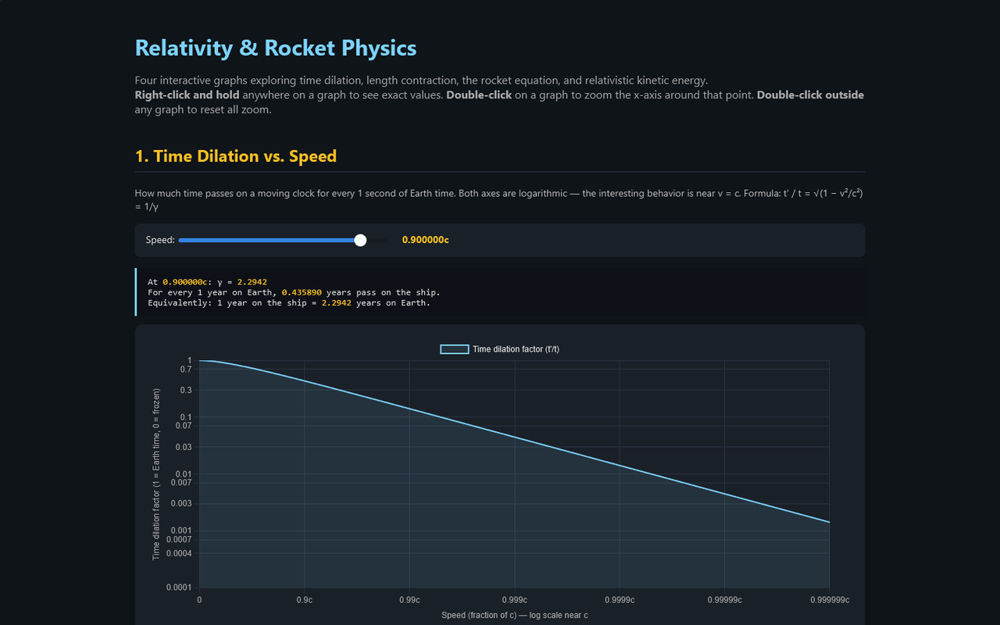
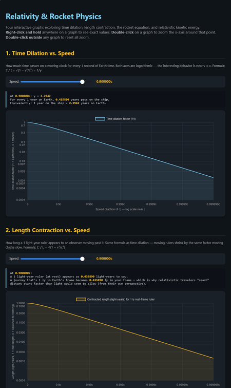
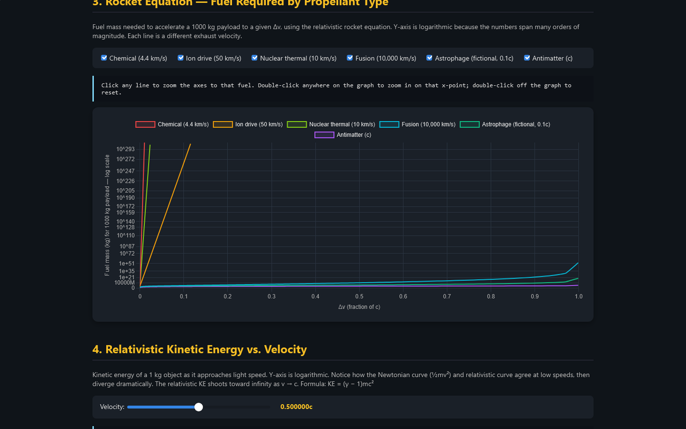

# Relativity & Rocket Physics

Four interactive graphs that show what happens near the speed of light: slowing clocks, shrinking rulers, the fuel a rocket really needs, and the "energy wall" of kinetic energy.

**[▶ Open the live app](https://timothyhadfield.github.io/relativity-graphs/)** · best on a laptop (the graphs use right-click and double-click)

  
  &nbsp;
  

  

## Features
- **Time dilation** — log-scale graph from 0 to 0.999999c, plus a speed slider that tells you how much ship time passes per Earth year.
- **Length contraction** — how short a 1 light-year ruler looks as you fly past it, with its own slider and readout.
- **Rocket equation** — fuel needed to push a 1,000 kg payload to a given Δv for chemical, ion, nuclear thermal, fusion, "Astrophage" and antimatter drives. Toggle each fuel, or click a line to zoom the axes to that fuel.
- **Relativistic kinetic energy** — (γ − 1)mc² next to Newton's ½mv², with comparisons in Hiroshima bombs and seconds of the Sun's output.
- **Exact values on demand** — right-click and hold on any graph for a crosshair and the precise numbers.
- **Zoom** — double-click a graph to zoom in around that point; double-click off the graphs to reset.

## Built with
One HTML file with vanilla JavaScript and [Chart.js](https://www.chartjs.org/).
